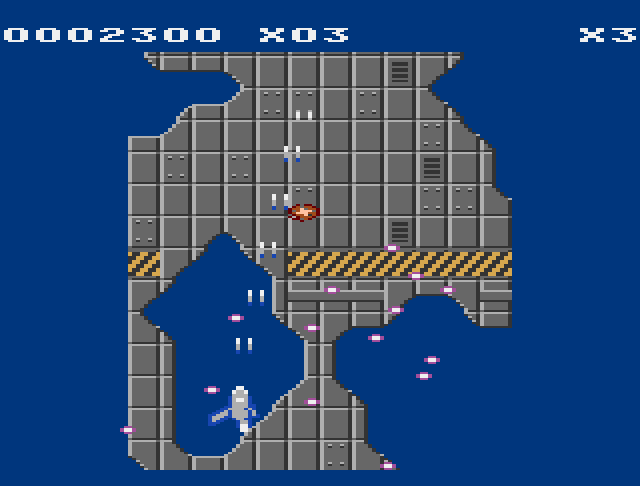
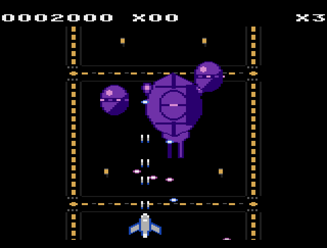
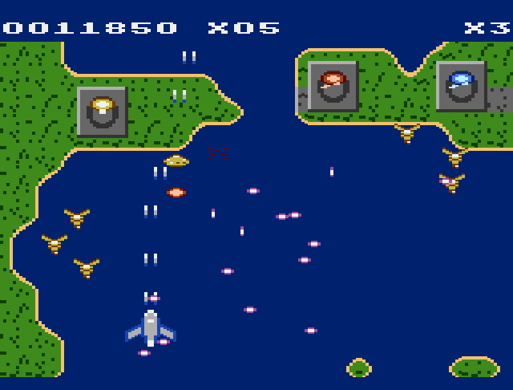
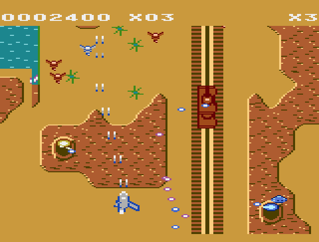
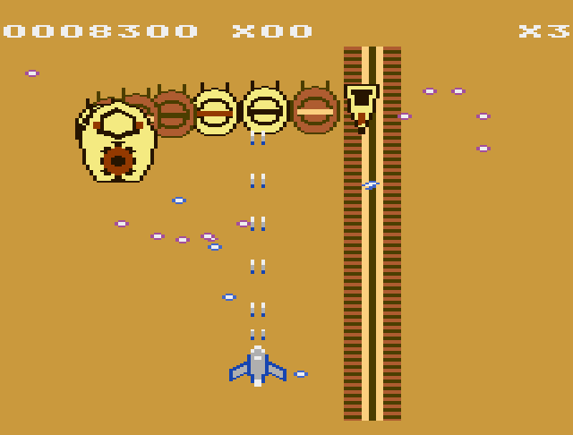

# Atari Gamma Force

A vertical shoot-'em-up for the Atari 7800: a demake of
[MegaGammaForce](https://github.com/jasonfrowe/MegaGammaForce) for the
Picocomputer 6502. Two buttons, two weapons, the Vulcan and the Radiant
Sword; a color chain; weapons that level up; bosses taken apart piece by
piece. Written in [7800basic](https://github.com/7800-devtools/7800basic)
with an assembly display engine for smooth vertical scrolling.

[](https://jasonfrowe.github.io/AtariGammaForce/)

**[▶ Play it in your browser](https://jasonfrowe.github.io/AtariGammaForce/)** (keyboard or gamepad), or on [jasonrowe.org](https://jasonrowe.org/Atari7800/gammaforce/). It runs in [js7800_astrocart](https://github.com/jasonfrowe/js7800_astrocart), an Atari 7800 emulator with the AstroCart's math unit and second POKEY.

**Status:** playable through all nine stages, to the ending. Stage 1 (the
fortress at sea, and the GAMMA CORE), stage 2 (NEON SPIRES, a city at
night that winds and splits, with wasps, tanks, towers to fly around and
the SPIRE WARDEN), stage 3 (IRON TIDE: islands, gunboats, and LEVIATHAN,
a battleship longer than the screen) and stage 4 (SCORCHED SANDS: rock
plateaus, oases, armored trains on a railway, and DUNE WYRM, a sandworm
winding a figure of eight), stage 5 (FROZEN STRAIT: pack ice, icebergs,
blizzards, and GLACIER CRAWLER) and stage 6 (ASCENT: climbing out of the
atmosphere as the ocean darkens below, past the Earth's limb into space
among satellites, to HALO STATION, a ring station with orbiting gun
satellites) and stage 7 (SEA OF TRANQUILITY: the Moon's craters, lunar
bases with domes and landing pads, rovers, and MASS DRIVER, a hovering
rail cannon that sways as it fires slugs down the screen) and stage 8
(DEEP FIELD: drifts of solid asteroids that stop shots and wreck the
ship, and HIVE MOTHERSHIP, a swaying alien hive with a great eye) and
stage 9 (CORONA: low over the Sun, through solar flares that erupt in
turn and burn the ship, to GAMMA PRIME, a golden sunburst with orbiting
prisms whose core opens only when the Hyper Sword breaks a node atop it)
scroll
pixel-exact to
MegaGammaForce's music converted to POKEY, with its enemy waves, ground
units and bullet patterns; the Vulcan, the Radiant Sword (absorbing pink
bullets), the Hyper Sword, the color chain, score and lives work. See [docs/DESIGN.md](docs/DESIGN.md) for the plan and
[docs/ENGINE.md](docs/ENGINE.md) for how the scrolling and the stage banks
work.

## Screenshots

| | |
|---|---|
|  |  |
| The title: the logo's palette cycles, as in Astro Wing | Stage 1, SKY FORTRESS |
|  |  |
| The GAMMA CORE | Stage 2, NEON SPIRES: the city winds and splits |
|  |  |
| The SPIRE WARDEN | Stage 3, IRON TIDE |
|  |  |
| LEVIATHAN, the battleship, part of the map | Stage 4, SCORCHED SANDS: trains on the railway |
|  |  |
| DUNE WYRM, a chain of eleven sprites | The results after a boss |

Screenshots and the GIF above are from the A7800 emulator (`tools/play.sh`;
`tools/make_gif.py` records the GIF), at twice size.

## Manual

A 16-page manual in the style of the old Atari booklets, ready to print
and fold: [5 x 7 inches](docs/manual/Atari_Gamma_Force_Manual_5x7.pdf) or
[4 x 6.5 inches](docs/manual/Atari_Gamma_Force_Manual_4x6.5.pdf). Its text is
`docs/manual/manual.html`; `tools/make_manual.py` prints it (`--shots` takes
its screenshots again, in the emulator).

## Controls

| | |
|---|---|
| Joystick | Move |
| Button 1 | Vulcan: hold to fire (also the button of a one-button stick) |
| Button 2 | Radiant Sword: cuts, and absorbs pink bullets |
| Both, gauge full | Hyper Sword (36 pink bullets absorbed; the ship glows gold when it's ready) |
| Pause | Pause |

The HUD shows the score, the chain (three gems lit in the chain's color,
and its level), the sword gauge and the lives. Extra lives come at 50,000
points and 100,000, then every 100,000.

On the title, left and right choose the starting stage, and up and down
the mode: EXPERT (all the enemy's fire), NORMAL (about half the enemy
bullets: fans and rings fire half as many over the same spread, single
shots every other time, and at most 10 at once instead of 16), or TEDDY
BEAR (NORMAL's bullets, five ships instead of three, and armor: each ship
takes one hit before it is lost, and shows bluer while it has it).

## Building

Needs [wasmtime](https://wasmtime.dev) (7800basic is vendored in
`tools/7800basic` as WebAssembly):

```sh
tools/build.sh                 # -> build/gammaforce.a78
```

or with CMake: `cmake --preset default && cmake --build --preset default`.

Test builds: `GF_DEFINES="CHEAT BOSSTEST STAGE2TEST" tools/build.sh` makes
`build/gammaforce-test.a78` with any of: an invulnerable ship, a start at
the boss, a start at a later stage (`STAGE2TEST` to `STAGE9TEST`), no cutscenes (`NOCUT`; and
`FPS30`, `PROFILE`).

Run it in [A7800](https://github.com/7800-devtools/a7800):

```sh
a7800 a7800 -cart build/gammaforce.a78
```

## Layout

| Path | |
|---|---|
| `src/gammaforce.bas` | The game (7800basic) |
| `src/asm/engine.asm` | Scroll engine and sprite plotter |
| `src/asm/music.asm` | POKEY music player |
| `tools/vgm2pokey.py` | MegaGammaForce's OPL2 VGM music to POKEY data |
| `src/gfx/`, `src/gen/` | Generated graphics and data (committed; made by `tools/gen_assets.py`) |
| `assets/art7800.txt` | The sprites, drawn as text |
| `assets/mgf/` | MegaGammaForce's maps, waves and music (`tools/import_mgf.py`; stage 7's `tools/import_mgf7.py`, stage 8's `tools/import_mgf8.py`, stage 9's `tools/import_mgf9.py`) |
| `src/asm/objects.asm` | Enemy bullets, enemy movement, hit tests, score |
| `tools/7800basic/` | 7800basic v0.41 (stock) |
| `tools/test_scroll.sh` | Headless engine regression test |
| `tools/play.sh` | Headless scripted play (inputs, screenshots, memory peeks) |
| `tools/pcprof.py`, `tools/dmalog.py` | CPU cycle profile and MARIA DMA load per line, from the [a7800 fork](https://github.com/jasonfrowe/a7800)'s development tools (`A7800_PROFILE`, `A7800_DMA_LOG`) |
| `tools/idlelog.py` | Per displayed frame: time in catch-up steps, the draw step and the wait for vblank (an `IDLELOG` build) |
| `tests/` | Play scripts (`tools/fps_test.sh` runs `stage1_fps.txt` for the frame rate) |
| `docs/reference/` | Local copy of the 7800basic guide |
| `storyboard/` | The story: narrative bible, storyboards, character sheets, the in-game script (`script.txt`), the cutscene pictures (`panels/`, with the rules for drawing them) |
| `tools/gen_cutscenes.py` | The cutscenes (banks 11-16) from the script and the pictures |
| `tools/gen_jukebox.py` | The jukebox's track list and screen |
| `tools/cutscene7800.py` | Checks a cutscene picture against the 7800's rules and converts it |
| `tools/generate_music.py`, `tools/musicgen/` | MegaGammaForce's OPL2 music generator (the story's tunes, `assets/music/`) |

The art is drawn for the 7800, not converted: sprites are text in
`assets/art7800.txt` (one character per pixel, `.123`), the stages' tiles
and the bosses are drawn by `tools/tiles7800.py` and `tools/boss7800.py`,
and the title logo by `tools/logo7800.py`. Stage 2's boss code is
`src/boss1.bas`, `src/boss2.bas` and `src/boss3.bas` (each lives in its
stage's bank).
`tools/art_preview.py` shows the sprites in 7800 colors at the TV's 2:1
pixel shape. The music is converted from MegaGammaForce's VGMs by
`tools/gen_music.sh` (and the story's tunes, made with
`tools/generate_music.py` and remastered in Furnace, from `assets/music/`).

The story: a cutscene plays before every stage and after the last, a
picture or the speaker's portrait over 40-column teletype text (fire
finishes a page, then turns it). `storyboard/script.txt` is the script;
`tools/gen_cutscenes.py` makes the cutscene banks from it and the
pictures in `storyboard/panels/`. Test builds for scripted play add
`NOCUT` (no cutscenes, no high score screens).

High scores: a table of five for each difficulty, saved on a High Score
Cart or an AtariVox/SaveKey (7800basic's hiscore.asm, game ID $4746;
without a device they last until power off). After a game over or the
epilogue a score that makes the table takes three initials (up and down
choose a letter, fire locks it in); the title shows the table when left
alone.

The jukebox: on the title, right past STAGE 9 to JUKEBOX, then fire. Its
22 tracks are all the game's music (left and right choose one, B1 plays
or stops it, B2 goes back), with meters for the lead, bass and drums.

Regenerating the art needs Python with Pillow and numpy:

```sh
python3 -m venv .venv && .venv/bin/pip install -r requirements.txt
.venv/bin/python tools/gen_assets.py
.venv/bin/python tools/gen_cutscenes.py
```

## License

GPL-3.0, like MegaGammaForce and Astro Wing. 7800basic is under its own
license (`tools/7800basic/LICENSE.txt`).
