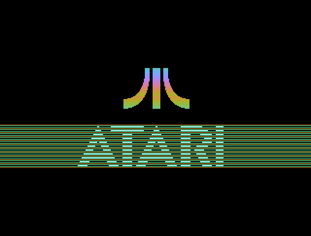
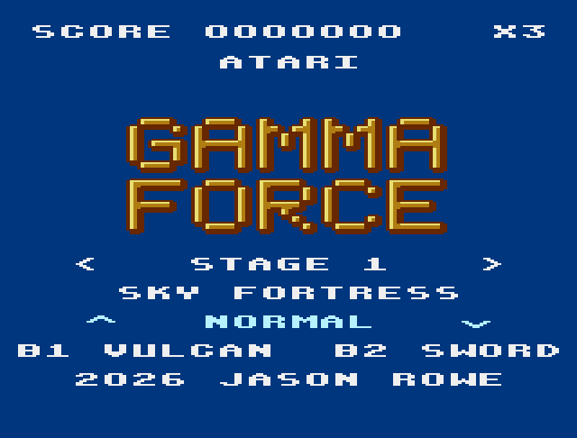
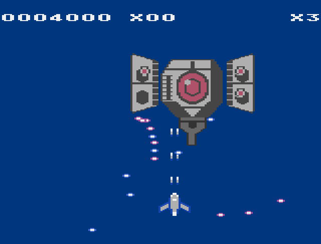
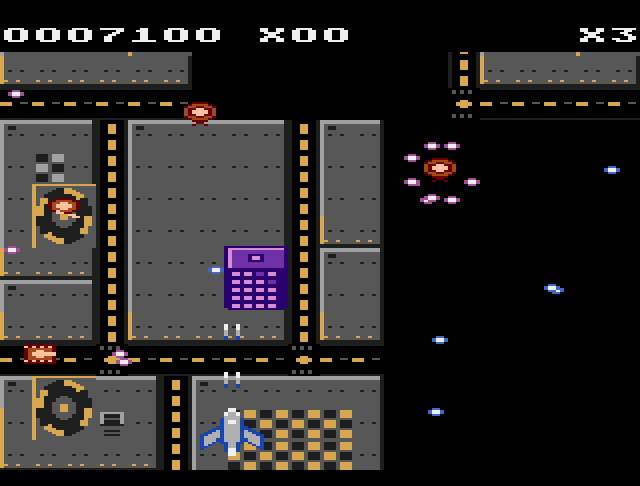
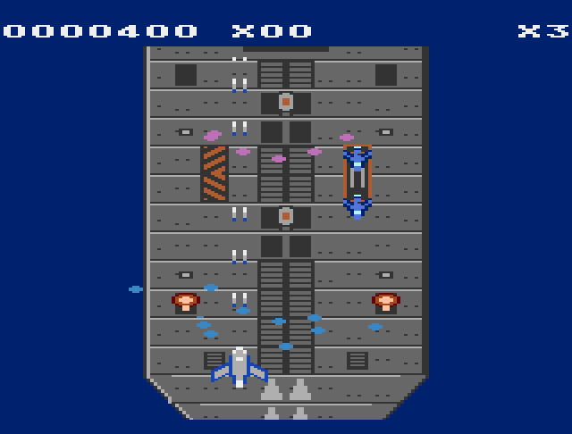
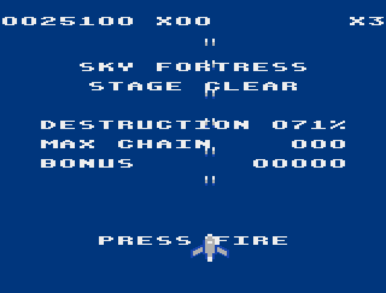

# Atari Gamma Force

A vertical shoot-'em-up for the Atari 7800: a demake of
[MegaGammaForce](https://github.com/jasonfrowe/MegaGammaForce) for the
Picocomputer 6502. Two buttons, two weapons, the Vulcan and the Radiant
Sword; a color chain; weapons that level up; bosses taken apart piece by
piece. Written in [7800basic](https://github.com/7800-devtools/7800basic)
with an assembly display engine for smooth vertical scrolling.



**Status:** playable through four stages, round and round. Stage 1 (the
fortress at sea, and the GAMMA CORE), stage 2 (NEON SPIRES, a city at
night that winds and splits, with wasps, tanks, towers to fly around and
the SPIRE WARDEN), stage 3 (IRON TIDE: islands, gunboats, and LEVIATHAN,
a battleship longer than the screen) and stage 4 (SCORCHED SANDS: rock
plateaus, oases, armored trains on a railway, and DUNE WYRM, a sandworm
winding a figure of eight) scroll pixel-exact to
MegaGammaForce's music converted to POKEY, with its enemy waves, ground
units and bullet patterns; the Vulcan, the Radiant Sword (absorbing pink
bullets), the Hyper Sword, the color chain, score and lives work. See [docs/DESIGN.md](docs/DESIGN.md) for the plan and
[docs/ENGINE.md](docs/ENGINE.md) for how the scrolling and the stage banks
work.

## Screenshots

| | |
|---|---|
|  |  |
| The title: the logo's palette cycles, as in Astro Wing | Stage 1, SKY FORTRESS |
|  |  |
| The GAMMA CORE | Stage 2, NEON SPIRES: the city winds and splits |
|  |  |
| The SPIRE WARDEN | Stage 3, IRON TIDE |
|  |  |
| LEVIATHAN, the battleship, part of the map | Stage 4, SCORCHED SANDS: trains on the railway |
|  |  |
| DUNE WYRM, a chain of eleven sprites | The results after a boss |

Screenshots and the GIF above are from the A7800 emulator (`tools/play.sh`;
`tools/make_gif.py` records the GIF), at twice size.

## Controls

| | |
|---|---|
| Joystick | Move |
| Button 1 | Vulcan: hold to fire (also the button of a one-button stick) |
| Button 2 | Radiant Sword: cuts, and absorbs pink bullets |
| Both, gauge full | Hyper Sword (36 pink bullets absorbed) |
| Pause | Pause |

On the title, left and right choose the starting stage, and up and down
the mode: NORMAL, or TEDDY BEAR, with about half the enemy bullets (fans
and rings fire half as many over the same spread, single shots every
other time, and at most 10 at once instead of 16).

## Building

Needs [wasmtime](https://wasmtime.dev) (7800basic is vendored in
`tools/7800basic` as WebAssembly):

```sh
tools/build.sh                 # -> build/gammaforce.a78
```

or with CMake: `cmake --preset default && cmake --build --preset default`.

Test builds: `GF_DEFINES="CHEAT BOSSTEST STAGE2TEST" tools/build.sh` makes
`build/gammaforce-test.a78` with any of: an invulnerable ship, a start at
the boss, a start at stage 2, 3 or 4 (`STAGE2TEST`, `STAGE3TEST`,
`STAGE4TEST`; and
`FPS30`, `PROFILE`).

Run it in [A7800](https://github.com/7800-devtools/a7800):

```sh
a7800 a7800 -cart build/gammaforce.a78
```

## Layout

| Path | |
|---|---|
| `src/gammaforce.bas` | The game (7800basic) |
| `src/asm/engine.asm` | Scroll engine and sprite plotter |
| `src/asm/music.asm` | POKEY music player |
| `tools/vgm2pokey.py` | MegaGammaForce's OPL2 VGM music to POKEY data |
| `src/gfx/`, `src/gen/` | Generated graphics and data (committed; made by `tools/gen_assets.py`) |
| `assets/art7800.txt` | The sprites, drawn as text |
| `assets/mgf/` | MegaGammaForce's maps, waves and music (`tools/import_mgf.py`) |
| `src/asm/objects.asm` | Enemy bullets, enemy movement, hit tests, score |
| `tools/7800basic/` | 7800basic v0.41 (stock) |
| `tools/test_scroll.sh` | Headless engine regression test |
| `tools/play.sh` | Headless scripted play (inputs, screenshots, memory peeks) |
| `tests/` | Play scripts (`tools/fps_test.sh` runs `stage1_fps.txt` for the frame rate) |
| `docs/reference/` | Local copy of the 7800basic guide |

The art is drawn for the 7800, not converted: sprites are text in
`assets/art7800.txt` (one character per pixel, `.123`), the stages' tiles
and the bosses are drawn by `tools/tiles7800.py` and `tools/boss7800.py`,
and the title logo by `tools/logo7800.py`. Stage 2's boss code is
`src/boss1.bas`, `src/boss2.bas` and `src/boss3.bas` (each lives in its
stage's bank).
`tools/art_preview.py` shows the sprites in 7800 colors at the TV's 2:1
pixel shape. The music is converted from MegaGammaForce's VGMs by
`tools/gen_music.sh`.

Regenerating the art needs Python with Pillow and numpy:

```sh
python3 -m venv .venv && .venv/bin/pip install -r requirements.txt
.venv/bin/python tools/gen_assets.py
```

## License

GPL-3.0, like MegaGammaForce and Astro Wing. 7800basic is under its own
license (`tools/7800basic/LICENSE.txt`).
