# ATARI GAMMA FORCE — STORYBOARD & STATIC CUT SCREENS

This document defines the cut screens, visual compositions, dialogue scrollers, and staging designed for the Atari 7800 architecture.

---

## Technical Framing & Format Guidelines

* **Target Display:** Atari 7800 MARIA Graphic Processor (160A mode: 160×240 with wide 2:1 pixels, or 320B/C for high-res static title/interstitial artwork).
* **Cinematic Screen Layout:**
  * **Top 70% (160×150 px):** Graphic illustration window (dithered pixel artwork, dramatic high-contrast sci-fi key visual).
  * **Middle 4 px:** Tri-color Atari brand hazard stripe (Red, Orange, Yellow) acting as the cinematic divider bar.
  * **Bottom 30% (160×55 px):** Black letterbox teletype console. Displays speaker callsign, tactical coordinates, and typewriter-style scrolling narrative text. Pressing Fire (Button 1 or 2) skips or advances the text.
* **Core Design Principle:** Every dialogue transmission actively warns and prepares the player for the specific tactical and environmental hazards of the upcoming stage.

---

## Cut Screen Flow Overview

```mermaid
flowchart TD
    Title["TITLE SCREEN\nMode / Stage Select"] --> CS0["CUT SCREEN 0: PROLOGUE\n'Scramble Order: Code Gamma'\n[Prep for Stg 1: Flak & Sword Absorption]"]
    CS0 --> S1["STAGE 1: SKY FORTRESS"]
    S1 --> TR1["STAGE 2 BRIEFING CARD\n[Prep for Stg 2: City Towers & Skyscrapers]"]
    TR1 --> S2["STAGE 2: NEON SPIRES"]
    S2 --> TR2["STAGE 3 BRIEFING CARD\n[Prep for Stg 3: Ocean Gunboats]"]
    TR2 --> S3["STAGE 3: IRON TIDE"]
    S3 --> TR3["STAGE 4 BRIEFING CARD\n[Prep for Stg 4: Desert Armored Trains]"]
    TR3 --> S4["STAGE 4: SCORCHED SANDS"]
    S4 --> TR4["STAGE 5 BRIEFING CARD\n[Prep for Stg 5: Winter Blizzard & Winds]"]
    TR4 --> S5["STAGE 5: FROZEN STRAIT"]
    S5 --> CS1["CUT SCREEN 1: EARTH ORBIT BREAKOUT\n'Atmospheric Ignition'\n[Prep for Stg 6: Space Debris & Satellites]"]
    CS1 --> S6["STAGE 6: ASCENT"]
    S6 --> TR6["STAGE 7 BRIEFING CARD\n[Prep for Stg 7: Lunar Rockets from Behind]"]
    TR6 --> S7["STAGE 7: SEA OF TRANQUILITY"]
    S7 --> CS2["CUT SCREEN 2: BEYOND THE MOON\n'Into the Deep Field'\n[Prep for Stg 8: Solid Asteroid Fields]"]
    CS2 --> S8["STAGE 8: DEEP FIELD"]
    S8 --> CS3["CUT SCREEN 3: POINT OF NO RETURN\n'The Corona Beckons'\n[Prep for Stg 9: Lethal Solar Flares]"]
    CS3 --> S9["STAGE 9: CORONA"]
    S9 --> CS4["CUT SCREEN 4: EPILOGUE & CREDITS\n'The Sun Burns Clean'"]
```



---

## Detailed Storyboards & Dialogue Scripts

---

### CUT SCREEN 0: PROLOGUE — "SCRAMBLE ORDER: CODE GAMMA"
**Placement:** Plays after pressing Fire on the Title Screen before Stage 1 (Sky Fortress).

#### Visual Composition
* **Panel A (Catapult Bay):** Subterranean launch tube beneath the ocean. Steam and coolant vapor billow across magnetic catapult rails. High-intensity spotlights slice through the mist.
* **Panel B (The Interceptor):** Front 3/4 angle of the **GF-01 Gamma Force**. Twin vulcan muzzle ports gleam; the crystalline bow emitter radiates faint pink-blue electromagnetic halos.
* **Panel C (Hero Pilot):** Close-up profile of Captain Maya "Vanguard" Kestrel in the cockpit. Her helmet visor is raised, eyes locked on the launch greenlights, hands firm on the flight sticks.

```
+--------------------------------------------------------+
|                                                        |
|     /======================================\           |
|    |   [ STEAM / MIST ]       [ CATAPULT ]  |          |
|    |      .---.              _              |          |
|    |     /     \      ____.-' `-._          |          |
|    |    | MAYA  |    <== GF-01 == >         |          |
|    |     \_____/      `---.____.-'          |          |
|     \======================================/           |
|                                                        |
+--------------------------------------------------------+
| [RED] ------------------------------------------------ |
| [ORANGE] --------------------------------------------- |
| [YELLOW] --------------------------------------------- |
+--------------------------------------------------------+
| EDC GROUND CONTROL // DR. THORNE:                      |
| "Gamma-1, the surface fleet has secured the bay.       |
| Hold Button 1 for your Vulcan guns, but keep your      |
| Radiant Sword (Button 2) ready: it absorbs all PINK    |
| bullets to charge your Hyper gauge. Blue fire cannot   |
| be blocked—dodge it! Catapult green. Launch, Maya!"    |
+--------------------------------------------------------+
```

---

### STAGE 2 TACTICAL INTERLUDE — "NEON CANYONS"
**Placement:** Pre-Stage 2 Transition Card (Neon Spires).

#### Visual Composition
* **Panel:** Cockpit HUD looking down into the dazzling night skyline of the cyber-city. Towering neon skyscrapers flank the flight vector. Ground tanks patrol the streets below.

```
+--------------------------------------------------------+
|     |  ||  |              |  ||  |                     |
|     |  ||  |    [ SKY ]   |  ||  |      *              |
|     | TOWER|              | TOWER|                     |
|     |  ||  |     ^ GF-01  |  ||  |                     |
|     |  ||  |    / \       |  ||  |                     |
|    [=== STREET LEVEL TANKS / NEON LIGHTS ===]          |
+--------------------------------------------------------+
| [RED] ------------------------------------------------ |
| [ORANGE] --------------------------------------------- |
| [YELLOW] --------------------------------------------- |
+--------------------------------------------------------+
| DR. THORNE // SECTOR 2 HAZARD ALERT:                   |
| "Maya, caution in the Neon Spires! The communications  |
| towers are indestructible! They block all Vulcan shots |
| and will crush your ship if you ram them. Fly around   |
| the towers while you bomb the tanks below!"            |
|                                                        |
| CAPTAIN KESTREL:                                         |
| "Copy that, Nathan. Navigating between the spires."    |
+--------------------------------------------------------+
```

---

### STAGE 3 TACTICAL INTERLUDE — "THE IRON CHANNELS"
**Placement:** Pre-Stage 3 Transition Card (Iron Tide).

#### Visual Composition
* **Panel:** Panoramic ocean vista with rocky island outcroppings. Heavy alien naval gunboats cut through foaming white wakes, turrets tracking the sky.

```
+--------------------------------------------------------+
|  [ ISLAND ]      ~~~~ WATER ~~~~         [ ISLAND ]    |
|                /===================\                   |
|               |  GUNBOAT (ARMORED)  |                  |
|                \===================/                   |
|      *             ^ GF-01                             |
|                   / \                                  |
|  ~~~~~~~~~~~~~~~~~~~~~~~~~~~~~~~~~~~~~~~~~~~~~~~~~~~~  |
+--------------------------------------------------------+
| [RED] ------------------------------------------------ |
| [ORANGE] --------------------------------------------- |
| [YELLOW] --------------------------------------------- |
+--------------------------------------------------------+
| DR. THORNE // SECTOR 3 HAZARD ALERT:                   |
| "The battle moves to open water! Heavy gunboats have   |
| blockaded the island channels. They maneuver quickly   |
| and unleash wide spreads of pink fans and blue rings.  |
| Clear the sea lanes before they deploy the Leviathan!" |
|                                                        |
| CAPTAIN KESTREL:                                         |
| "Gunboats in my sights. Sword ready. Going in!"        |
+--------------------------------------------------------+
```

---

### STAGE 4 TACTICAL INTERLUDE — "DESERT IRON RAILS"
**Placement:** Pre-Stage 4 Transition Card (Scorched Sands).

#### Visual Composition
* **Panel:** Blazing desert dunes and rocky plateaus. Twin heavy railway tracks stretch into the shimmering horizon, where an armored locomotive with multiple heavy gun cars thunders forward.

```
+--------------------------------------------------------+
|   [ ROCK MESA ]                      [ SAND DUNES ]    |
|                                                        |
|   ====== RAILWAY ====== [ ARMORED TRAIN ] ======       |
|    |#|#|#|#|#|#|#|#|   [ENG]-[GUN]-[CAR]-[CAR]         |
|                                                        |
|                   ^  GF-01 SHADOW ON SAND              |
+--------------------------------------------------------+
| [RED] ------------------------------------------------ |
| [ORANGE] --------------------------------------------- |
| [YELLOW] --------------------------------------------- |
+--------------------------------------------------------+
| DR. THORNE // SECTOR 4 HAZARD ALERT:                   |
| "Scorched Sands ahead! Scans detect multi-car armored  |
| trains rolling on the continental railway. Each car has|
| heavy armor and gun turrets. Strip the gun cars down,  |
| and watch the desert floor for seismic anomalies!"     |
|                                                        |
| CAPTAIN KESTREL:                                         |
| "I see the tracks. Armored train intercepted!"         |
+--------------------------------------------------------+
```

---

### STAGE 5 TACTICAL INTERLUDE — "THE BLIZZARD STRAIT"
**Placement:** Pre-Stage 5 Transition Card (Frozen Strait).

#### Visual Composition
* **Panel:** Brutal whiteout blizzard. Jagged floating icebergs and collapsing ice shelves amidst frozen pack ice. Frost forming on the cockpit canopy.

```
+--------------------------------------------------------+
|   \ \ \  [ HOWLING BLIZZARD / PACK ICE ]  / / /        |
|    \ \ \                                 / / /         |
|     [ ICEBERG ]       ^ GF-01       [ ICE SHELF ]      |
|                      / \  <- WIND SHEAR                |
|               ~~~ FREEZING WATER ~~~                   |
+--------------------------------------------------------+
| [RED] ------------------------------------------------ |
| [ORANGE] --------------------------------------------- |
| [YELLOW] --------------------------------------------- |
+--------------------------------------------------------+
| DR. THORNE // SECTOR 5 HAZARD ALERT:                   |
| "Brutal winter conditions in the Frozen Strait, Maya!  |
| Violent blizzard winds will buff your ship, and ice    |
| shelves are collapsing into the sea. Keep your flight  |
| vector steady and stop that Glacier Crawler!"          |
|                                                        |
| CAPTAIN KESTREL:                                         |
| "Canopy heating active. Fighting the wind shear now!"  |
+--------------------------------------------------------+
```

---

### CUT SCREEN 1: ACT I TO ACT II — "ATMOSPHERIC BREAKOUT"
**Placement:** Between Stage 5 (Frozen Strait) and Stage 6 (Ascent).

#### Visual Composition
* **Panel A:** Wide cinematic shot of the Gamma Force rocketing out of Earth’s atmosphere, blue thruster plumes igniting as the sky transitions from violet to ink-black space.
* **Panel B:** High orbit view: dead orbital satellites, severed space-elevator cables, and shattered platform debris floating around the ominous perimeter of **Halo Station**.

```
+--------------------------------------------------------+
|       *                 *                  .           |
|          [ SPACE DEBRIS & DEAD SATELLITES ]            |
|           /---------\     <--- HALO STATION            |
|          (  ( O )  )           RING PLATFORM           |
|           \---------/                                  |
|                                                        |
|              ^  [ GF-01 BOOSTING UPWARD ]              |
|             / \                                        |
|            /___\  <- Twin ion exhaust trails           |
|                                                        |
|  ~~~~~~ ( ( ( CLOUD TOPS & EARTH CURVATURE ) ) ) ~~~~~ |
+--------------------------------------------------------+
| [RED] ------------------------------------------------ |
| [ORANGE] --------------------------------------------- |
| [YELLOW] --------------------------------------------- |
+--------------------------------------------------------+
| DR. THORNE // ORBITAL INGRESS BRIEFING:                |
| "Earth's surface is secure, Maya! Booster stage engaged|
| for Stage 6. But take warning: low orbit is choked with|
| lethal space debris and dead satellites! Tumbling      |
| wreckage will crush your hull. Dodge the debris field!"|
|                                                        |
| CAPTAIN KESTREL:                                         |
| "Confirmed. Breaking orbit into the debris now!"       |
+--------------------------------------------------------+
```

---

### STAGE 7 TACTICAL INTERLUDE — "LUNAR CANNON & REAR THREAT"
**Placement:** Pre-Stage 7 Transition Card (Sea of Tranquility).

#### Visual Composition
* **Panel:** The stark grey moonscape of the Sea of Tranquility. Craters, domed facilities, and underground launch rails with red hazard lights strobing on the lunar ground.

```
+--------------------------------------------------------+
|   [ MOON CRATERS ]                   [ BASE DOMES ]    |
|                                                        |
|                    ^ GF-01                             |
|                   / \                                  |
|   --- WARNING: LAUNCH SILO DETECTED BELOW ---          |
|   [RED/YELLOW BLINK]  ^^^ ROCKET FROM BEHIND! ^^^      |
+--------------------------------------------------------+
| [RED] ------------------------------------------------ |
| [ORANGE] --------------------------------------------- |
| [YELLOW] --------------------------------------------- |
+--------------------------------------------------------+
| DR. THORNE // SECTOR 7 HAZARD ALERT:                   |
| "You're over the Moon, Maya, but WATCH YOUR REAR!      |
| Lunar launch rails are firing cargo rockets up from    |
| BEHIND your ship! When you see red and yellow warning  |
| blinks at the bottom of the screen, move immediately!" |
|                                                        |
| CAPTAIN KESTREL:                                         |
| "Understood! Keeping eyes glued to the bottom sensors!"|
+--------------------------------------------------------+
```

---

### CUT SCREEN 2: ACT II TO ACT III — "INTO THE DEEP FIELD"
**Placement:** Between Stage 7 (Sea of Tranquility) and Stage 8 (Deep Field).

#### Visual Composition
* **Panel A:** The Moon recedes in the background. The Gamma Force heads toward the vast asteroid drift separating Earth orbit from the inner solar corridor.
* **Panel B:** Cockpit view through Maya’s HUD: gigantic nickel-iron asteroids tumbling in the void. An eerie alien organic web and honeycomb silhouette looms deep inside the belt.

```
+--------------------------------------------------------+
|   ================ [ COCKPIT HUD ] =================   |
|         |                                |             |
|    .    |    [ SOLID NICKEL ASTEROIDS ]  |      *      |
|         |       .---.          .----.    |             |
|   *     |      ( AST )        ( HIVE )   |             |
|         |       `---'          `----'    |        .    |
|   ==================================================   |
+--------------------------------------------------------+
| [RED] ------------------------------------------------ |
| [ORANGE] --------------------------------------------- |
| [YELLOW] --------------------------------------------- |
+--------------------------------------------------------+
| DR. THORNE // SECTOR 8 HAZARD ALERT:                   |
| "Maya, Sector 8 is the Deep Field asteroid drift!      |
| These asteroids are solid rock—they block your Vulcan  |
| fire completely and will destroy your ship on contact! |
| Use your Radiant Sword to carve lanes through the      |
| rocks, and hunt down that Hive Mothership!"            |
|                                                        |
| CAPTAIN KESTREL:                                         |
| "Solid rock ahead. Powering up the sword. Punching in!"|
+--------------------------------------------------------+
```

---

### CUT SCREEN 3: POINT OF NO RETURN — "THE SOLAR CORONA"
**Placement:** Between Stage 8 (Deep Field) and Stage 9 (Corona).

#### Visual Composition
* **Panel A:** Sol fills the entire screen—an overwhelming, roiling wall of thermonuclear plasma. Prominences loop thousands of miles into space.
* **Panel B:** Anchored in the center of the inferno sits **Gamma Prime**, a golden sunburst fortress with orbiting prisms siphoning solar fury.
* **Panel C:** Maya’s cockpit illuminated in blazing amber and crimson light. The Radiant Sword field envelopes the hull in an auroral energy bubble.

```
+--------------------------------------------------------+
|           \ \ \ \   [ SOLAR PROMINENCE ]   / / / /     |
|          \ \ \  ( ( (   THE SUN: SOL   ) ) )  / / /    |
|         \ \  ( ( ( ( ( ( ( ( ( ) ) ) ) ) ) ) )  / /    |
|                                                        |
|               [ <#><#> GAMMA PRIME CITADEL <#><#> ]    |
|                                                        |
|                         ^                              |
|                       < A >   [ GF-01 IN SHIELD ]      |
|                      (  *  )                           |
+--------------------------------------------------------+
| [RED] ------------------------------------------------ |
| [ORANGE] --------------------------------------------- |
| [YELLOW] --------------------------------------------- |
+--------------------------------------------------------+
| DR. THORNE // SECTOR 9 HAZARD CRITICAL:                |
| "Maya, extreme danger! You are inside the solar corona!|
| Thermonuclear solar flares erupt across the surface    |
| in alternating waves. Watch the warning flickers—one   |
| touch of an active flare will vaporize the ship!       |
| Break their prisms and destroy Gamma Prime!"           |
|                                                        |
| CAPTAIN KESTREL:                                         |
| "The heat is intense, but the sword is holding!        |
| For Earth and Sol... THIS ENDS NOW!"                   |
+--------------------------------------------------------+
```

---

### CUT SCREEN 4: EPILOGUE & CREDITS — "THE SUN BURNS CLEAN"
**Placement:** Plays after destroying Gamma Prime in Stage 9.

#### Visual Composition
* **Scene 1 (The Destruction):** Gamma Prime’s golden prisms shatter. The siphon collapse triggers an implosion; the violent solar flares subside into a quiet, warm stellar glow.
* **Scene 2 (Return Trajectory):** The battle-scarred Gamma Force banks away from the serene golden Sun, engines purring on a gentle return burn toward the blue crescent of Earth.
* **Scene 3 (The Pilot):** Maya removes her helmet, wiping away sweat. Her face is warmed by the morning sunlight through the canopy. Nathan’s voice comes through the comm speaker loud and clear.

```
+--------------------------------------------------------+
|                                                        |
|      .   *              .               *       .      |
|                 ( ( (  EARTH  ) ) )                    |
|                ( ( (  AT PEACE ) ) )                   |
|                                                        |
|           \                                            |
|            \==>  [ GF-01 RETURNING HOME ]              |
|                                                        |
|     *                   .                 *            |
|                                                        |
+--------------------------------------------------------+
| [RED] ------------------------------------------------ |
| [ORANGE] --------------------------------------------- |
| [YELLOW] --------------------------------------------- |
+--------------------------------------------------------+
| MISSION RESULTS // ALL SYSTEMS NOMINAL:                |
| "GAMMA PRIME COLLAPSED. SOLAR OUTPUT NORMALIZING.      |
|                                                        |
| ALL CLEAR. GAMMA CORE IS DEAD. THE SUN BURNS CLEAN."   |
|                                                        |
| DR. THORNE:                                            |
| "Telemetry is clean, Maya. Earth is waiting for you.   |
| Welcome home, Captain."                                |
+--------------------------------------------------------+
```
