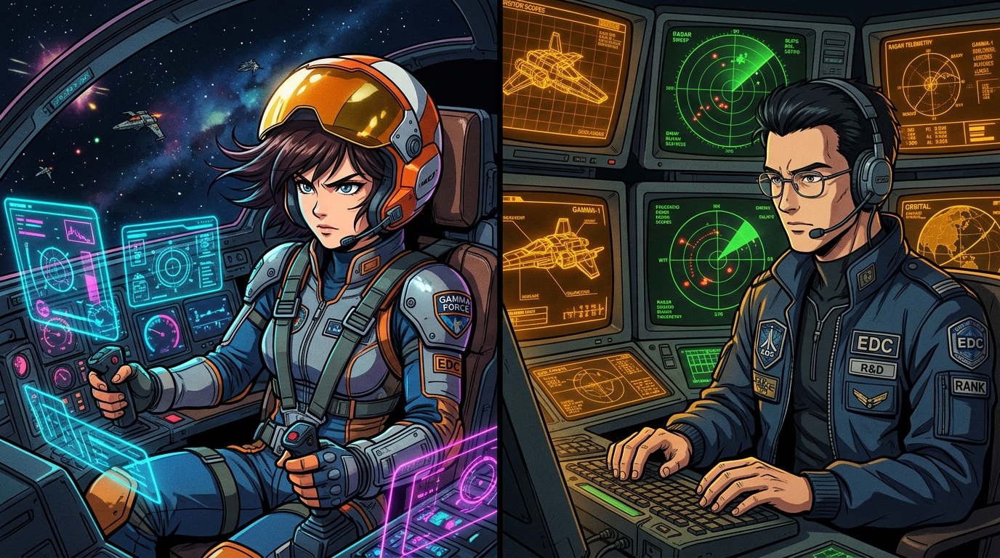

# ATARI GAMMA FORCE — CHARACTER CONCEPT PROFILES



---

## 1. Captain Maya "Vanguard" Kestrel

```
       .---.
      /_____\     CALLSIGN: Gamma-1
     |  (o)  |    RANK: Captain, Earth Orbital Interceptor Division
     |   ~   |    ASSIGNMENT: Pilot, GF-01 Gamma Force
      \_____/     STATUS: Active / Sortie Authorized
```

### Background & Psychology
* **Age:** 28
* **Homeworld:** Earth (New Seattle Orbital Sector)
* **Personality:** Fierce, unflappable, with lightning-fast tactile reflexes. Maya was the ace test pilot for the high-G atmospheric prototype interceptor program. When the invasion fleet disabled the planetary defense grid, she executed a high-altitude emergency dead-stick landing to deliver the sole surviving airframe to the subterranean Marianas skunkworks.
* **Combat Philosophy:** "Keep your nose forward, read the terrain ahead, and let the sword drink the fire." Maya knows every inch of the Gamma Force, intuitively pacing her weapon cycles and maneuvering through impossible terrain bottlenecks.

### Key In-Flight & Sector Transition Dialogue
* *"Catapult pressure green. Sword capacitor holding stable. Maya Kestrel rolling out!"*
* *(Approaching Neon Spires)*: *"I see the skyline. Those communications towers are massive—if I clip a wing on one of those spires, it’s all over. Weaving between buildings now."*
* *(Approaching Iron Tide)*: *"Ocean channel sighted. Gunboats are swarming the open water. Time to sink some hulls."*
* *(Approaching Scorched Sands)*: *"Look at the dust cloud over the dunes. That's not a convoy—it's an armored supply train on the railway. Setting intercept course."*
* *(Approaching Frozen Strait)*: *"Wind shear is vicious down here. The blizzard is blinding, and icebergs are shearing off into the channel. Keeping altitude steady."*
* *(Approaching Ascent)*: *"Igniting booster stage. Leaving atmosphere... Space debris everywhere! Satellites and dead rocket stages tumbling across the flight path!"*
* *(Approaching Sea of Tranquility)*: *"Warning alarms singing! Rail bases on the lunar regolith are firing booster canisters straight up behind me! Breaking left!"*
* *(Approaching Deep Field)*: *"The asteroid belt is solid rock. Vulcan rounds are ricocheting off the boulders. Switching to sword sweeps to clear a lane through the drift."*
* *(Approaching Corona)*: *"Canopy thermal gauges are screaming red! Solar flares are erupting like tidal waves across the screen. Thorne... if the sword holds, we finish this right now."*
* *(Post-Stage 9 Victory)*: *"Gamma Prime is down. Sol is clear. All flares subsiding... Thorne, prepare recovery bay. I'm coming home."*

---

## 2. Dr. Nathan Thorne

```
      .-----.
     / [o] [o]\   ROLE: Chief Tactical Engineer & Mission Ops Commander
    (|   ---  |)  STATION: Sub-Oceanic Command Hub (Marianas Bunker)
     |   ===  |   PROJECT: Project Radiant Gamma
      \_____/
```

### Background & Psychology
* **Age:** 33
* **Specialty:** Advanced Magnetic Containment, Sensor Telemetry & Xenotech Logistics
* **Personality:** Calm under immense pressure, razor-sharp analytical mind, deeply devoted to bringing his pilot back alive. Nathan cracked the alien plasma resonance frequencies, designing the magnetic coils that allow the Radiant Sword to absorb pink enemy fire.
* **Mission Function:** Nathan is Maya’s eyes on the horizon. He monitors long-range sensor telemetry and issues immediate tactical briefings between stages, warning Maya of the specific terrain hazards, weather conditions, and enemy ambushes waiting in the next sector.

### Tactical Briefings & Hazard Warnings (Preparing Player for Next Level)
* **Pre-Stage 1 (Sky Fortress Launch):**  
  > *"Maya, catapult release in three... two... one! Clear the launch bay. Use your Vulcan for long-range sweeps, but remember: your Radiant Sword absorbs pink needle and orb fire to charge your Hyper gauge. Blue fire cannot be absorbed—dodge it!"*
* **Pre-Stage 2 (Neon Spires Warning — Tall Buildings):**  
  > *"Heads up, Maya! The route through Sector 2 runs through the heart of the Neon Spires. The city has indestructible skyscraper towers rising straight into your flight ceiling! They stop all weapons and will crush your ship if you collide. Fly around the towers while you neutralize the ground tanks below!"*
* **Pre-Stage 3 (Iron Tide Warning — Gunboats):**  
  > *"Radar detects heavy naval movement across the archipelago in Sector 3! The alien fleet has deployed armored gunboats throughout the open waters. They maneuver quickly and fire wide spread rings—keep your sword ready as you sweep the sea lanes!"*
* **Pre-Stage 4 (Scorched Sands Warning — Desert Trains):**  
  > *"You're entering the Scorched Sands, Maya. Long-range scans show heavy mineral transport trains rolling along the continental railway. Each armored train car is heavily fortified with turrets. Take out the locomotive and cars before they deliver their payload!"*
* **Pre-Stage 5 (Frozen Strait Warning — Winter Conditions & Winds):**  
  > *"Extreme arctic storm incoming! Sector 5 is locked in brutal winter conditions. You'll face howling blizzard winds, shifting pack ice, and massive falling ice shelves. Maintain tight control through the wind shear and find the Glacier Crawler!"*
* **Pre-Stage 6 (Ascent Warning — Space Debris):**  
  > *"Booster ignition confirmed! You're breaking through the stratosphere into low Earth orbit. Caution: the orbital shell is choked with lethal space debris and dead satellites! Colliding with tumbling debris will tear through your shields. Keep your eyes sharp!"*
* **Pre-Stage 7 (Sea of Tranquility Warning — Rockets from Behind):**  
  > *"You're over the lunar surface, Maya, but stay on high alert! Enemy ground rail installations are firing high-speed cargo canister rockets from BEHIND you! Watch the bottom of your tactical display—when you see the red-and-yellow launch warnings flashing, move immediately before the rockets shoot up under your thrusters!"*
* **Pre-Stage 8 (Deep Field Warning — Asteroid Fields):**  
  > *"Entering the Deep Field void. Warning: dense asteroid fields ahead! These asteroids are solid iron-nickel—they will stop your Vulcan fire dead and crush the Gamma Force on contact. Use your Radiant Sword to cut safely near the rock faces and watch for alien bio-forms lurking in the drift!"*
* **Pre-Stage 9 (Corona Warning — Dangerous Solar Flares):**  
  > *"This is it, Maya—the solar corona! Temperatures exceed two million degrees. Massive thermonuclear solar flares erupt across the chromosphere in alternating cycles. Watch the warning flickers on the surface—if you're caught in an erupting solar prominence, the heat will incinerate you instantly! Dodge the flares and destroy Gamma Prime!"*
* **Post-Stage 9 (Ending Briefing):**  
  > *"Sensors show total collapse of the alien siphon citadel. Solar output has stabilized. All systems clear. You did it, Maya... Earth is safe. Bring her home."*

---

## 3. The Coronal Entity / Primus Mind (GAMMA PRIME)

```
        / \
      /     \     DESIGNATION: Entity Gamma-0 / The Solar Siphoner
     <  (O)  >    ORIGIN: Unknown Deep Cosmic Cluster
      \     /     OBJECTIVE: Total Stellar Extraction
        \ /
```

### Nature & Purpose
* An ancient machine-biological gestalt intelligence. It travels across galactic arms, locating viable stars, establishing automated planetary suppression networks, and anchoring golden siphons into stellar coronas to drain star matter for planetary seed pods.
* It communicates not in words, but in cold machine telepathic frequency bursts translated by Thorne’s decryption matrix:
  * `[COMM-INTERCEPT // HARVEST CYCLE 84.7% // PURGE UNREGISTERED ANOMALY]`
  * `[SUB-CORE GAMMA COMPROMISED // REDIRECT DEFENSIVE ESCORT]`
  * `[CRITICAL ANOMALY // SOLAR EQUILIBRIUM BREACHED]`
