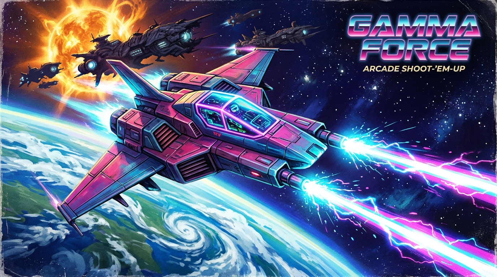
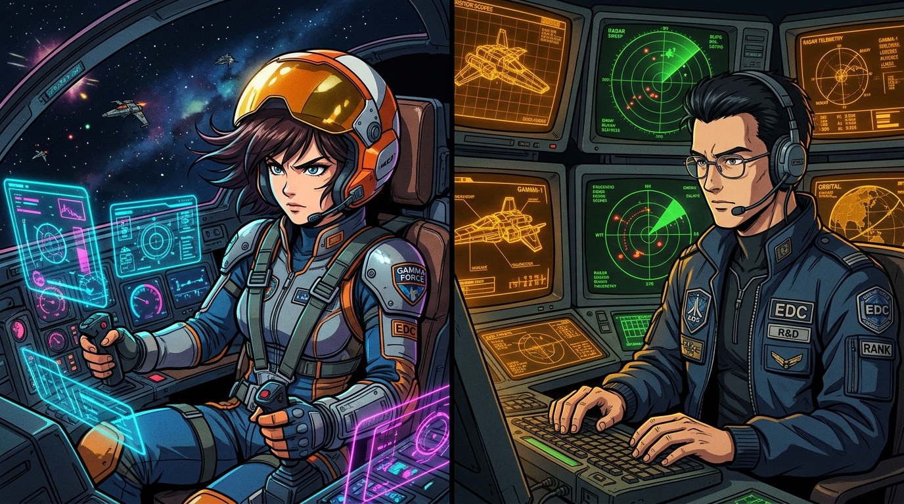
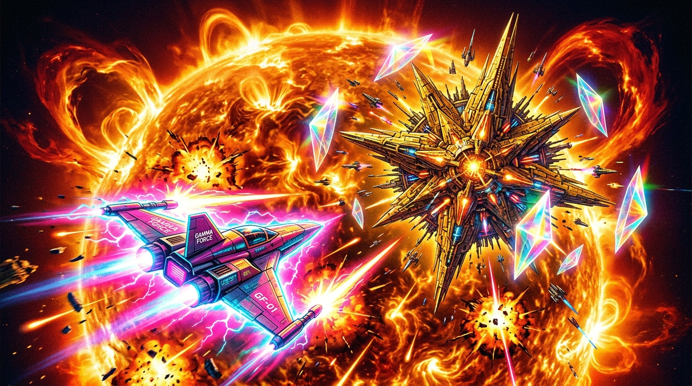

# ATARI GAMMA FORCE — STORYBOARD & CONCEPT PRODUCTION

Welcome to the **Atari Gamma Force Storyboard & Narrative Design Suite**.

This suite documents the narrative arc, visual storyboard, static cut screens, character profiles, and concept art for *Atari Gamma Force*, an authentic vertical shoot-'em-up on the Atari 7800.

---

## Storyboard Dossier Contents

| Document | Purpose |
|---|---|
| [**00_NARRATIVE_BIBLE.md**](00_NARRATIVE_BIBLE.md) | World lore, alien invasion premises, solar siphon mechanics, weapons lore (Vulcan, Radiant Sword, Hyper Sword), and narrative tone. |
| [**01_STORYBOARD_CUTSCREENS.md**](01_STORYBOARD_CUTSCREENS.md) | Detailed storyboard sequences, camera framing, screen layout specifications for Atari 7800 MARIA display modes, Atari hazard stripe divider styling, and dialogue/scroller scripts. |
| [**`02_CHARACTER_SHEETS.md`**](02_CHARACTER_SHEETS.md) | Bios, personality, visual design guidelines, and in-flight voice lines for **Captain Maya "Vanguard" Kestrel** (Female ace pilot, Gamma-1), **Dr. Nathan Thorne** (Male Tactical Operations & Chief Engineer), and the entity Gamma Prime. |
| [**`03_STAGE_NARRATIVE_LOGS.md`**](03_STAGE_NARRATIVE_LOGS.md) | Comprehensive stage-by-stage dossiers across all 9 stages: environmental descriptions, tactical objectives, specific hazard alerts, radio chatter, and boss threat breakdowns. |

---

## Visual Concept Art Gallery

### 1. Key Concept Art: The Gamma Force Soaring into Orbit
> *The GF-01 Gamma Force ascending past the upper stratosphere toward Earth orbit, twin Radiant Sword energy projectors ignited, facing the cosmic threat.*



---

### 2. Characters Concept Art: Pilot & Tactical Ops (Reversed Genders)
> *Captain Maya Kestrel (Gamma-1) in high-G flight suit and cockpit alongside Dr. Nathan Thorne at EDC Tactical Command.*



---

### 3. Climax Concept Art: The Solar Corona & Gamma Prime
> *Captain Kestrel dives into the roaring magnetic storms of the Sun's corona, enveloped in the protective gamma barrier of the Radiant Sword, charging the golden sunburst fortress Gamma Prime and its orbiting prisms.*



---

## The 9-Stage Odyssey & Sector Hazard Preparations

Every sector transition actively prepares the player for the unique gameplay and environmental hazard of the next stage:

```
====================================================================================================
 ACT I: THE OCCUPIED WORLD
 Stage 1: SKY FORTRESS       [Boss: GAMMA CORE]      - Flak grids & pink bullet absorption practice.
 Stage 2: NEON SPIRES        [Boss: SPIRE WARDEN]    - HAZARD: Indestructible tall skyscraper towers!
 Stage 3: IRON TIDE          [Boss: LEVIATHAN]       - HAZARD: Armored naval gunboats in open water!
 Stage 4: SCORCHED SANDS     [Boss: DUNE WYRM]       - HAZARD: Heavy multi-car desert armored trains!
 Stage 5: FROZEN STRAIT      [Boss: GLACIER CRAWLER] - HAZARD: Brutal winter blizzard & wind shear!
----------------------------------------------------------------------------------------------------
 ACT II: BREAKING THE TETHER
 Stage 6: ASCENT             [Boss: HALO STATION]    - HAZARD: Lethal space debris & dead satellites!
 Stage 7: SEA OF TRANQUILITY [Boss: MASS DRIVER]     - HAZARD: Ground rockets launching from BEHIND!
----------------------------------------------------------------------------------------------------
 ACT III: INTO THE SUN
 Stage 8: DEEP FIELD         [Boss: HIVE MOTHERSHIP] - HAZARD: Solid asteroid fields blocking weapons!
 Stage 9: CORONA             [Boss: GAMMA PRIME]     - HAZARD: Deadly erupting cyclical solar flares!
====================================================================================================
```
